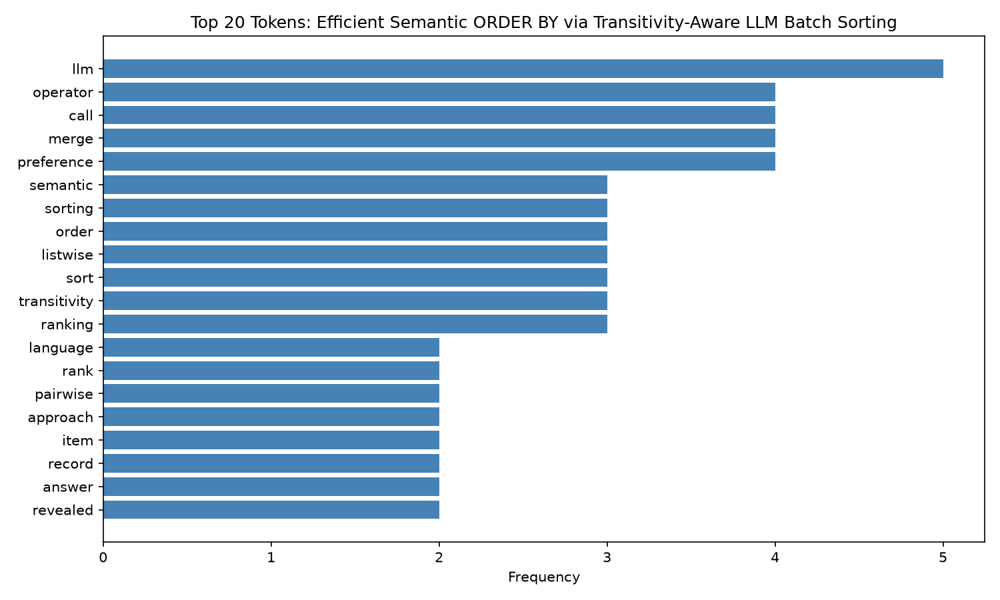
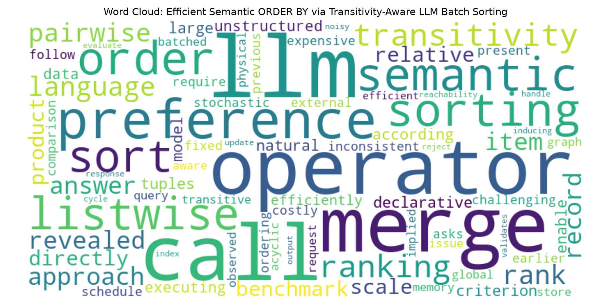

# Web Mining and Applied NLP Project Report

Web Mining and Applied NLP | Project 06

## Overview

This project introduces a complete
natural language processing pipeline
for analyzing text extracted from web documents.

The objective is to acquire HTML,
validate document structure,
extract and clean text,
engineer NLP features,
analyze vocabulary patterns,
and persist the results.

The project extends the earlier EVTL architecture
by introducing an explicit Analyze stage.

The resulting architecture is
Extract, Validate, Transform, Analyze, Load (EVTAL).

## Tools and Methods

The project uses:

- Python for pipeline orchestration and processing.
- Requests for retrieving HTML documents.
- BeautifulSoup for parsing and extracting HTML content.
- spaCy for tokenization and linguistic text processing.
- Pandas for structured data transformation.
- Token counts and type-token ratios for describing vocabulary.
- Matplotlib for token frequency visualizations.
- WordCloud for visual exploration of vocabulary.
- CSV for persistent output.
- Logging for execution records.
- Ruff, ty, and pytest for code verification.
- Zensical and GitHub Pages for published documentation.
- NTLK for lemmatization

The example retrieves an academic paper's
abstract page from arXiv.

The pipeline implements five stages:

- **Extract** - retrieve HTML and preserve the raw document.
- **Validate** - verify the expected HTML structure.
- **Transform** - extract metadata, clean text, and engineer NLP features.
- **Analyze** - compute token frequencies and create visualizations.
- **Load** - save the processed dataset to a CSV file.

The Transform stage uses spaCy
with the `en_core_web_sm` English language model.

The example calculates token counts,
unique token counts, type-token ratios,
and other derived text features.

The Analyze stage produces a token frequency chart
and a word cloud.

## Custom Modifications

1. The pipeline parses the HTML document from the arXiv abstract page for the paper **"Efficient Semantic ORDER BY via Transitivity-Aware LLM Batch Sorting"** *(arXiv ID: 2611.32073)*.
2. The pipeline was modified to output the 25 most frequent tokens in a bar chart instead of the top 20. With this change, I am expecting the the data/processed/jugurtha_top_tokens.png to show 25 tokens instead of 20.
3. The pipeline was modified to include lemmatization of tokens using NLTK's WordNetLemmatizer. This change is expected to reduce the number of unique tokens and provide a more accurate representation of the vocabulary used in the text.

## Verification

A successful execution displays:

    Pipeline executed successfully!

The pipeline records execution details in a project log.

The following artifacts are created:

- `data/raw/jugurtha_raw.html` - original HTML document.
- `data/processed/jugurtha_processed.csv` - processed NLP dataset.
- `data/processed/jugurtha_top_tokens.png` - token frequency chart.
- `data/processed/jugurtha_wordcloud.png` - word cloud visualization.

These results demonstrate that the pipeline can
acquire, validate, transform, analyze,
and persist web text data.

Automated tests provide additional verification
of the pipeline's expected behavior.

## Results

The pipeline produced the following results:

- `data/processed/jugurtha_processed.csv` - contains the processed NLP dataset with token counts, unique token counts, type-token ratios, and other derived text features.
  - 241 abstract words were extracted from the HTML document.
  - 163 token counts with 123 unique tokens were identified, resulting in a type-token ratio of 0.7546.
- `data/processed/jugurtha_top_tokens.png` - displays a bar chart of the 25 most frequent tokens in the processed text.
- `data/processed/jugurtha_wordcloud.png` - shows a word cloud visualization of the processed text, highlighting the most prominent terms

## Interpretation

- The pipeline successfully extracted and processed the text from the HTML document, producing a dataset with 241 abstract words. After text preprocessing and tokenization, 163 tokens were identified, of which 123 were unique.
- This resulted in a type-token ratio (TTR) of 0.7546, indicating relatively high lexical diversity, as approximately 75% of the identified tokens were unique. The top 25 tokens visualization provides insight into the most frequently occurring terms, while the word cloud offers a visual representation of the dominant vocabulary
- Overall, the results demonstrate how NLP techniques can transform unstructured HTML content into structured text data and generate useful insights into its vocabulary and word frequency distribution.

## Documentation Index

- **Home** - this landing page
- [**Project Instructions**](project-instructions.md)
- [**Glossary**](glossary.md)
- [**NLP Evolution**](nlp-evolution.md)

## Project Links

- [GitHub Repository](https://github.com/jugurthakacimi/nlp-06-nlp-pipeline)
- [Example Pipeline](https://github.com/jugurthakacimi/nlp-06-nlp-pipeline/blob/main/src/nlp/pipeline_web_html.py)
- [Example Configuration](https://github.com/jugurthakacimi/nlp-06-nlp-pipeline/blob/main/src/nlp/config.py)
- [Transform Stage](https://github.com/jugurthakacimi/nlp-06-nlp-pipeline/blob/main/src/nlp/stage03_transform.py)
- [Analyze Stage](https://github.com/jugurthakacimi/nlp-06-nlp-pipeline/blob/main/src/nlp/stage04_analyze.py)

## Project Resources

- [Project Instructions](project-instructions.md)
- [NLP Evolution](nlp-evolution.md)
- [Professional Python Guide](https://denisecase.github.io/pro-analytics-02/)
- [Professional Python Project Explainer](https://pup-pack.github.io/professional-python-project-explainer/)
